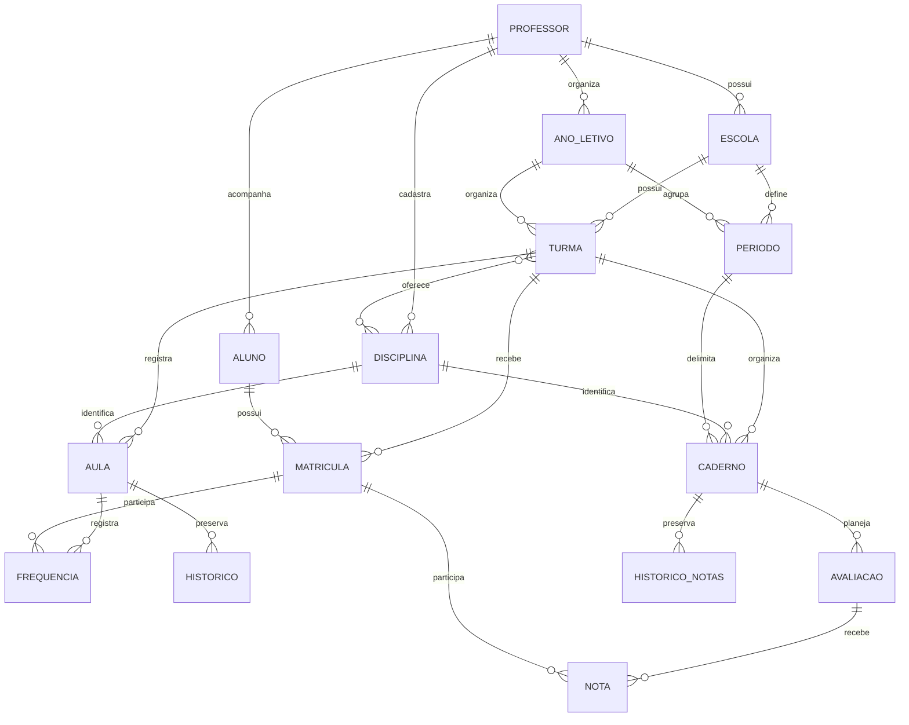

# Arquitetura inicial e decisões de implementação

Data: 19/10/2026.

O usuário autorizou o início do projeto. Para avançar sem bloquear a base, foram adotadas as premissas abaixo. As regras pedagógicas ainda devem ser detalhadas antes das respectivas funcionalidades.

## Estrutura da aplicação

- Monólito Django com páginas renderizadas no servidor.
- Interface responsiva em HTML/CSS, sem dependência de serviços externos para fontes ou scripts.
- Contas de professores com autenticação do Django e senha armazenada como hash.
- SQLite no desenvolvimento; configuração preparada para PostgreSQL.
- Funcionamento conectado. Sem cache offline ou service worker nesta etapa.

## Vínculos

Todos os registros possuem professor proprietário, data de criação e data da última alteração. Um ano letivo identifica o ano civil na conta do professor. Os períodos pertencem a uma escola e ano, permitindo calendários diferentes entre escolas.

A turma identifica escola, ano, nome e turno, com uma ou mais disciplinas opcionais. O aluno é independente do ano: suas matrículas registram os vínculos com as turmas.

## Isolamento e validação

- Listas, detalhes e edições filtram pelo usuário autenticado.
- IDs de outro professor retornam 404 nas telas de consulta e edição.
- O proprietário é atribuído no servidor e não pode ser escolhido pelo formulário.
- As opções de relacionamentos dos formulários só mostram registros da própria conta.
- Validações do modelo verificam a propriedade dos relacionamentos por chave estrangeira.
- Disciplinas da turma são filtradas e validadas pelo formulário de múltipla seleção.
- Restrições no banco impedem duplicação de escolas, anos, disciplinas, períodos, turmas e matrículas conforme suas respectivas chaves.
- Alunos podem ter o mesmo nome. A identificação interna opcional ajuda a distinguir homônimos.
- Datas dos períodos pertencem ao ano escolhido, com fim igual ou posterior ao início.
- Páginas autenticadas enviam cabeçalhos para evitar armazenamento em cache.
- Não há exclusão de registros pedagógicos pela interface nesta etapa.

Ao criar novas telas, APIs, importadores ou comandos, manter as mesmas verificações de propriedade. Operações em lote do ORM podem ignorar validações de `save()`; não utilizá-las como atalho para alterações sem validar os vínculos.

## Preservação de histórico

- Matrículas existentes preservam aluno e turma; a situação pode ser alterada.
- Transferências devem encerrar o vínculo anterior e criar um novo.
- Turmas com matrículas preservam escola e ano letivo.
- Anos com períodos existentes não podem ser alterados se as datas ficarem incompatíveis.
- Relacionamentos usam proteção contra exclusão dos registros referenciados.

Datas de atualização não constituem auditoria completa. Aulas/frequência e cadernos/notas possuem históricos próprios com autor, momento, motivo e diferenças entre valores anteriores e novos.

Chamadas e histórico são gravados na mesma transação. A versão da aula e um identificador do conjunto de matrículas detectam telas desatualizadas. Uma atualização condicional de versão impede sobrescrita silenciosa, inclusive no SQLite. O registro de histórico não possui tela de edição e seu modelo rejeita alterações em registros existentes.

A frequência respeita as datas de entrada e saída, inclusive. Matrículas antigas mantêm datas vazias até revisão; nenhuma data real é inferida na migração. As regras de compatibilidade, cálculo e cancelamento estão em ETAPA3.md.

Cadernos são únicos por turma/disciplina/período e guardam regras configuráveis. A versão compartilhada do caderno serializa alterações de regras, avaliações, notas e cancelamentos; um identificador das matrículas detecta mudança do conjunto de alunos. Escritas e auditoria são atômicas. Notas usam Decimal; resultados são calculados na consulta. Regras e limites da recuperação estão em ETAPA4.md. Cancelamentos preservam dados e deixam de participar dos cálculos.

## Telas existentes

1. Entrada, criação de conta e recuperação de senha.
2. Visão geral com contagens reais, turmas e primeiros passos.
3. Lista com busca e paginação para cada cadastro.
4. Criação e edição com mensagens de validação.
5. Detalhe da turma com disciplinas e alunos matriculados.
6. Troca de senha pelas rotas de autenticação do Django.
7. Registro de aulas, listagem com filtros, chamada e consulta de frequência da turma.
8. Correção de conteúdos/chamadas, cancelamento sem apagar dados e histórico de alterações.
9. Cadernos com regras configuráveis, provas/trabalhos/atividades, notas, entregas, recuperação, resultados e histórico.
10. Relatórios de turma e ficha individual por turma/disciplina/período, com PDF, CSV e impressão.

## Relatórios

A Etapa 5 adiciona consultas sem novas tabelas. ReportFilterForm valida conta e compatibilidade dos vínculos; report_services monta os dados chamando grade_summary e frequency_rows, preservando as regras das etapas anteriores. Um mesmo conjunto de dados alimenta HTML, impressão, PDF e CSV. Downloads são privados e sem cache. ReportLab gera PDFs no servidor; CSV usa a biblioteca padrão, com proteção contra fórmulas. pypdf é dependência exclusiva dos testes de exportação. Detalhes e limites em ETAPA5.md.

## Limites e decisões pedagógicas abertas

- Nível de ensino ainda não informado; a base permite nomes livres de turmas e disciplinas.
- Regras de notas e recuperação configuráveis implementadas conforme ETAPA4.md; não há fechamento anual, múltiplas recuperações ou decisão oficial de aprovação. Frequência não aplica abono automático.
- O recorte por ano civil é uma premissa inicial; calendários que atravessam anos exigirão ajuste.
- Compartilhamento entre professores, aplicativo nativo, PWA instalável e sincronização offline não estão implementados.
- Não houve validação de hospedagem, SMTP real ou PostgreSQL.
- Próxima etapa: experiência no celular/PWA, somente após nova autorização do usuário.

